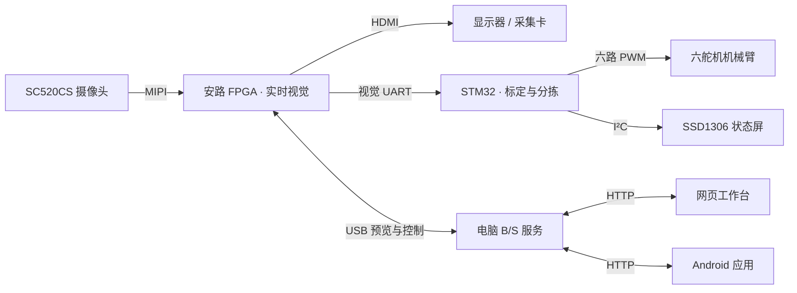

# FPGA创新设计竞赛_安路选题二_项目

FPGA创新设计竞赛安路选题二｜安路 FPGA 实时图像处理与目标识别，STM32 六舵机机械臂自动分拣，支持网页与安卓监控控制。

Anlogic Track 2 FPGA competition project with real-time vision, STM32 six-servo robotic sorting, and web and Android monitoring and control.

## 项目概览

项目将摄像头采集、实时图像处理、目标识别、机械臂抓放和远程监控串成一套完整的视觉分拣系统。安路 FPGA 同时输出带识别叠加的 HDMI 画面、供电脑监控的 USB 数据，以及供 STM32 使用的目标坐标。STM32 在本地完成标定、批次调度与六路舵机控制。网页端和 Android 端通过电脑服务共享画面、设备状态和事件记录。

|组件|主要功能|交付版本|
|---|---|---|
|安路 FPGA|MIPI 摄像头输入、图像滤镜、视觉识别、OSD、HDMI、USB 与目标串口|2026-10-30 HDMI 采集兼容版|
|STM32F103C8T6|五点标定、批次分拣、六路 PWM、连续抓放、OLED 状态|2026-10-28 连续抓放版|
|电脑网页端|实时预览、设备控制、抓拍录像、分拣工作台与事件管理|安路视界 B/S 3.0.2|
|Android 端|移动监控、设备控制、录像回看与事件通知|安路视界 3.0.2，versionCode 6|

## 系统架构

## FPGA 实时视觉

- **视频通路**　SC520CS 摄像头经 MIPI 输入，经过图像处理、识别和 OSD 合成后，以 1280×720、60 Hz 输出 HDMI 画面，可连接显示器或采集卡。
- **图像处理与识别**　支持滤镜显示、人脸候选检测、圆形与方形目标识别及数字识别，在画面上叠加识别状态与目标标记。
- **分拣数据**　分拣模式可提供最多四个目标，通过视觉 UART 输出目标快照。电脑端通过 USB 状态协议 5 获取画面、模式及分拣状态。
- **设备控制**　支持开发板拨码选模式和 USB 远程入口。摄像头水平与俯仰舵机使用独立 PWM 引脚。

## STM32 分拣与机械臂

- **五点标定**　使用方块 3 依次采集五个工作台点，以仿射拟合将图像像素转换为工作台坐标。现有 31 点模型进一步将工作台位置转换为机械臂动作参数。
- **批次排序**　目标稳定后确认整批，按实际 X 坐标升序排列，X 相同时按 Y 坐标升序。圆形数字奇数放左、偶数放右，方形跳过。
- **连续抓放**　批次执行期间冻结目标。中间目标放下后抬臂并直接转移到下一目标，最后一件完成后闭爪回默认姿态。各段采用五次平滑轨迹，CH5 先抬后转、最后下降。
- **现场状态**　SSD1306 单页显示标定和运行状态。PB12 可用于锁定暂停，按 RESET 恢复。

## 电脑网页端与 Android

电脑端通过 USB 串口连接 FPGA，在浏览器提供实时预览和控制。支持拍照、手动录像、人脸触发录像、历史记录与事件回看。打开 `/sort` 可进入分拣工作台，查看扫脸预览、分拣阶段、目标信息和事件缩略图。默认服务端口为 `8768`，以启动窗口显示的地址为准。

Android 应用连接同一电脑服务，提供原生监控页、设备控制、视频回看和事件列表。分拣页展示当前阶段及四个目标槽位，应用可接收已保存的人脸录像、方形异常和分拣故障相关通知。应用包名为 `cn.fpgavision.monitor`。

## 接线与快速上手

|连接|接口|
|---|---|
|FPGA 到电脑|开发板 USB，预览与控制串口 921600 baud|
|FPGA 到 STM32|GPIOA6 / J1 第 7 脚 TX → PB11 / USART3_RX，共地，3.3 V TTL，115200、8N1|
|机械臂六路 PWM|CH1–CH6 对应 PA0、PA1、PA2、PA3、PA6、PA7，舵机独立供电并共地|
|OLED|PB6 SCL、PB7 SDA，I²C 地址 0x3C|
|画面输出|FPGA HDMI → 显示器或采集卡|

1. 完整解压项目，用 TD 下载 `release/latest_plus_v3_hdmi_capture.bit`，用 ST-Link 烧录 `release/robot_arm_control.hex`。
2. 安装 Python 并加入 PATH。运行 `安装电脑端依赖.bat`，再运行 `启动电脑端.bat`。在网页中选择 FPGA 对应的 COM 口。
3. 手机安装 `release/Anlogic-Vision-v3.0.2.apk`，与电脑处于同一局域网时，填入服务窗口显示的局域网地址。
4. 拨码 `1011` 进入本地 SORT，拨码 `1100` 使用远程入口。等待扫脸并回到俯视位，按 OLED 提示将方块 3 依次放在 (10,10)、(20,10)、(15,20)、(5,20)、(25,20) cm。每点采集完成后移走标定块，再按提示进行下一点。复位后按同样流程重新标定。
5. 放置待分拣工件。识别稳定后，系统按批次完成抓取与左右放置。

完整引脚与操作步骤见 [接线与操作](docs/接线与操作.md)。机械臂细节见 [MCU 工程说明](mcu/README.md)。

## 目录与源码构建

|目录|内容与入口|
|---|---|
|`fpga/`|RTL、IP、ROM、引脚与时序约束。运行 `打开FPGA工程.bat` 刷新项目内路径，再用安路 TD 6.2.1 从综合开始完整运行|
|`mcu/`|STM32 源码、标定参数、Keil 工程和离线测试。运行 `打开MCU工程.bat`，使用 µVision 5、ARM Compiler 5 和 STM32F1 器件包构建|
|`pc_bs/`|Python B/S 服务、静态页面与测试，依赖由 `requirements.txt` 管理。详见 [电脑端说明](pc_bs/README.md)|
|`android/`|Android Java 源码、界面资源与构建脚本。详见 [安卓说明](android/README.md)|
|`release/`|FPGA bit、STM32 HEX、已签名 APK 和 SHA-256 校验清单|
|`docs/`|整套系统的接线与部署步骤|

工程按相对目录组织，整体移动后使用根目录脚本打开 FPGA 工程。Android 重建使用 JDK、Android SDK Build Tools 36.0.0、Android API 36.1 和 Python。配置 `ANDROID_HOME`、`JAVA_HOME` 后运行 `android/build_apk.ps1`。覆盖安装原发布版时使用相同签名。

## 验证记录

- FPGA 交付 bit 对应构建的布线时序报告记录 Setup 余量 **+0.173 ns**、Hold 余量 **+0.020 ns**。
- MCU 发布 HEX 的构建和校验记录见 [固件报告](mcu/firmware/build_report.json)。机械臂状态机、标定和连续抓放另有离线测试。
- 电脑端 **39 项测试通过**。项目 ZIP 已在另一目录解压核对 TD、ROM、Keil 工程引用及发布文件 SHA-256。
